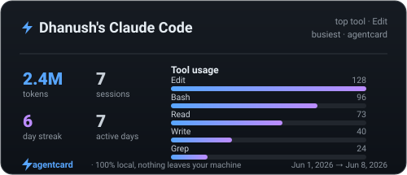
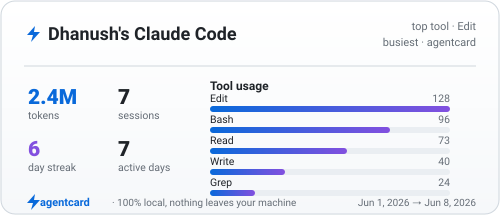
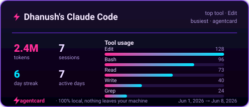
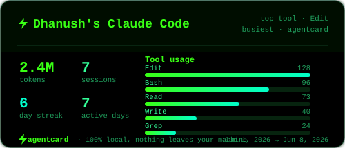

<div align="center">



# ⚡ agentcard

**github-readme-stats, but for AI pair-programming.**

One command turns your **real** local Claude Code logs into a gorgeous, embeddable
SVG stat card for your GitHub profile. 100% local — nothing leaves your machine.

```bash
npx agentcard
```

[](https://www.npmjs.com/package/agentcard)
[](./LICENSE)
[](https://nodejs.org)
&nbsp;·&nbsp; **[Try it with zero setup →](#-zero-setup-demo)**

</div>

---

## Why

You spend hours pair-programming with Claude Code. That effort is invisible.
`agentcard` reads the transcripts already sitting on your disk
(`~/.claude/projects/**/*.jsonl`) and renders a shareable card:

> **2.4M tokens · 340 sessions · top tool: Edit · 18-day streak**

Drop it in your profile README. Every card carries a small **⚡ agentcard**
footer — so when someone sees yours, they find the tool. That's the whole trick.

## 🚀 Quick start

```bash
# Scan your real Claude Code logs and write agentcard.svg
npx agentcard

# Pick a theme and a name
npx agentcard --theme neon --name "Your Name"
```

Then paste the snippet it prints into your profile `README.md`:

```md
[](https://github.com/Danush-Aries/agentcard)
```

> Tip: commit `agentcard.svg` to your profile repo and re-run `npx agentcard`
> whenever you want to refresh the numbers. Or wire it into a scheduled GitHub
> Action to keep it live.

## 🎬 Zero-setup demo

No Claude Code logs? No API keys? No problem. A sample transcript is bundled, so
this renders a full card **100% offline**:

```bash
npx agentcard --demo
```

## 🎨 Theme gallery

| `dark` (default) | `light` |
|:---:|:---:|
|  |  |
| **`neon`** | **`terminal`** |
|  |  |

```bash
npx agentcard --theme dark|light|neon|terminal
```

## 🔒 How it reads your logs (and why it's private)

Claude Code already writes every session to disk as JSONL under
`~/.claude/projects/`. `agentcard`:

1. **Discovers** every `*.jsonl` transcript (streaming, line-by-line — a
   multi-hundred-MB history stays cheap).
2. **Parses** each line defensively — malformed, partial, or truncated lines are
   skipped, never fatal.
3. **Aggregates** only anonymous counters: total in/out tokens, session count,
   a per-tool histogram (Edit / Read / Bash / …), your longest active-day
   streak, busiest project, and first/last activity.
4. **Renders** a self-contained SVG.

**Nothing is uploaded. No network calls. No API keys.** Your prompts, code, and
file contents never leave your machine — only the aggregate numbers make it onto
the card. Don't commit raw logs; commit the card.

## 🧾 What ends up on the card

| Metric | Source |
|---|---|
| **Tokens** | sum of `usage.input_tokens + usage.output_tokens` across assistant turns |
| **Sessions** | distinct session transcripts |
| **Tool usage** | histogram of `tool_use` blocks by tool name |
| **Day streak** | longest run of consecutive active UTC days |
| **Active days** | distinct days with activity |
| **Busiest project** | project (cwd) with the most sessions |

## ⚙️ CLI reference

```
npx agentcard [options]

  --demo              render from bundled sample logs (offline, no real logs)
  -t, --theme <name>  dark | light | neon | terminal   (default: dark)
  -o, --out <file>    output path                       (default: agentcard.svg)
  -n, --name <name>   name shown on the card
  -d, --dir <path>    override log dir (default: ~/.claude/projects)
  -h, --help          show help
  -v, --version       print version
```

## 📦 Use as a library

```ts
import { collectStats, renderCard } from "agentcard";

const { stats } = await collectStats();          // reads ~/.claude/projects
const svg = renderCard(stats, { theme: "neon", name: "You" });
```

## 🛠️ Develop

```bash
npm install
npm run build
npm test          # 35 assertions: parser fuzz, stats math, golden SVG snapshots
npx . --demo
```

## 🤝 Contributing

Issues and PRs welcome — new themes especially. If agentcard put a smile on your
profile, a ⭐ helps other developers find it.

## 📄 License

MIT © 2026 [Dhanush Shankar](mailto:danushankar3@gmail.com)

<div align="center">

<sub>Built with ⚡ by pair-programming with Claude Code — and now you can prove it.</sub>

</div>
